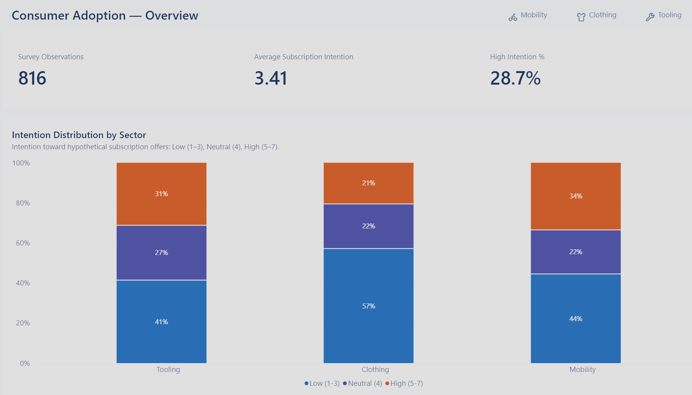
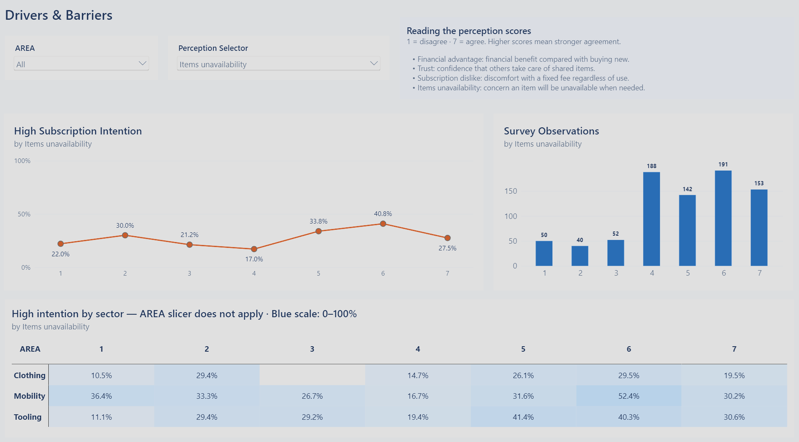
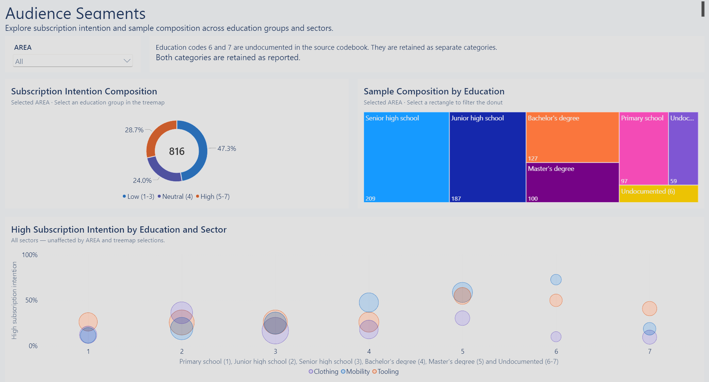
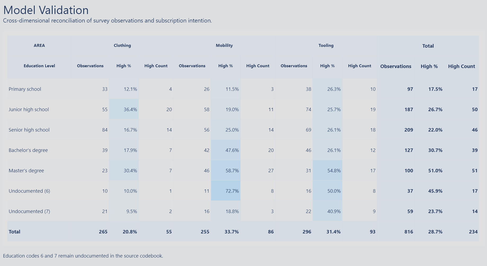

# Consumer Adoption — Power BI Dashboard

A hands-on project exploring consumers' stated intentions to adopt hypothetical subscription-based product/service offers across **Mobility, Clothing and Tooling**. Using a public Mendeley research dataset, the objective was to implement an end-to-end Power BI workflow: Power Query preparation, dimensional modelling, DAX, interactive report design and validation.

The results describe survey observations—not population-level adoption estimates.

## Dashboard

### Overview

**How does subscription intention differ across sectors?**

Across **816 observations**, high intention is **33.7% in Mobility**, **31.4% in Tooling** and **20.8% in Clothing**. High intention corresponds to scores 5–7 on the seven-point response Likert scale.

The stacked columns retain the full distribution—low (1–3), neutral (4) and high (5–7)—so the comparison goes beyond a single average. Screenshot labels round sector shares to whole percentages.

### Drivers & Barriers

**How are different consumer perceptions associated with subscription intention?**

An interactive Field Parameter switches between financial advantage, trust, subscription dislike and items unavailability. The sector selector filters the percentage and observation-count charts, making sample sizes visible alongside each percentage.

The comparison heatmap keeps all three sectors visible on a fixed 0–100% scale, independently of the sector selection.

### Audience Segments

**How do intention distributions and high-intention percentages vary across education categories and sectors?**

The donut shows intention composition, while the treemap shows the sample's education mix. Selecting an education category filters the donut within the selected sector, connecting sample composition with the distribution of responses.

The bubble chart compares high-intention percentages across education categories and sectors, with bubble size representing observation count. It remains a stable three-sector comparison when the upper visuals are filtered. 

Education codes 6 and 7 are undocumented and remain separate categories without invented labels or an assumed attainment ranking.

### Model Validation

**Do the measures produce consistent results across sector and education filters?**

The matrix reconciles **816 observations** and **234 high-intention responses**, giving **28.7% overall high intention**. Row, sector and grand totals expose the relationship between counts and percentages across both dimensions.

Blue cells encode percentages on a fixed scale. Grand-total percentages are recalculated from counts rather than averaged from displayed cells.

## Technical implementation

Power Query imports the CSV through the configurable `CsvFilePath` parameter, assigns types and creates an observation-level index. A survey fact table connects to `DimSector` and `DimEducation`. A disconnected Field Parameter controls the perception axis.

Explicit DAX measures calculate counts, average intention, high-intention percentages and a dynamic subtitle. Slicers, tooltips, conditional formatting and report-page navigation support exploration.

## Data quality and validation

Documented checks cover duplicated source IDs, undocumented education categories, half-point FIN values and the VD1 response range. Source IDs are not unique, a generated ObservationID identifies imported rows without resolving respondent duplication. See the [validation record](docs/validation.md).

## Reproducing the report

1. Clone `Bortrex/consumer-adoption-powerbi`.
2. Download the public dataset from the [Mendeley Data V1 release](https://doi.org/10.17632/4n48pfcycx.1).
3. Locate `Proccessed_data_CSV.csv` and place it in a local `data/` directory at the repository root.
4. Open [consumer_adoption.pbip](consumer_adoption.pbip) in Power BI Desktop.
5. In Power Query, update the `CsvFilePath` parameter to the CSV’s full local path.
6. Apply the parameter change and refresh the model.

## References

Dethier, Fanny; De Hoe, Roxane; Muylaert, Coralie; Roman, Philippe; Ruwet, Coline; Thiry, Géraldine; Maréchal, Kevin (2023), *“Survey data on divers and barriers to consumers’ intention to adopt an SPSS offer - Brufonctionnel project”*, Mendeley Data, V1. [doi:10.17632/4n48pfcycx.1](https://doi.org/10.17632/4n48pfcycx.1).

## License

[![CC BY 4.0][cc-by-shield]][cc-by]

The source dataset is distributed under [CC BY 4.0](https://interoperable-europe.ec.europa.eu/licence/creative-commons-attribution-40-international-cc-40). This attribution applies to the original Mendeley dataset. The license of this repository Power BI project files is separate.

[cc-by]: http://creativecommons.org/licenses/by/4.0/
[cc-by-shield]: https://img.shields.io/badge/License-CC%20BY%204.0-lightgrey.svg

## Further documentation

- [Semantic model](docs/model.md)
- [Data dictionary](docs/data_dictionary.md)
- [DAX expressions](docs/dax_measures.md)
- [Validation results](docs/validation.md)

## Author

[@Bortrex](https://github.com/Bortrex)
