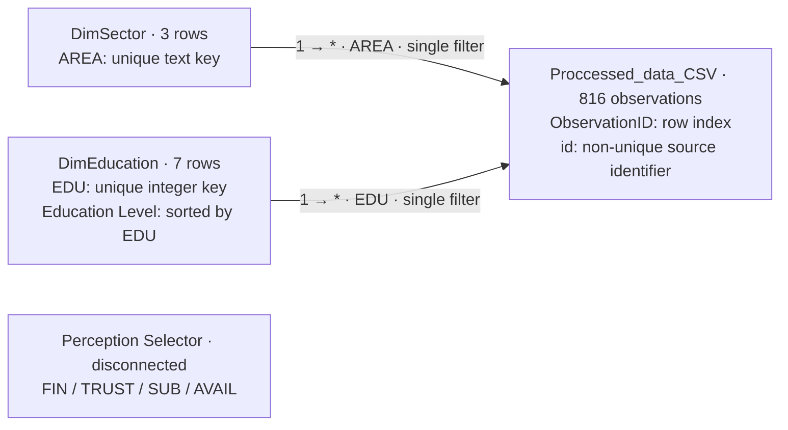
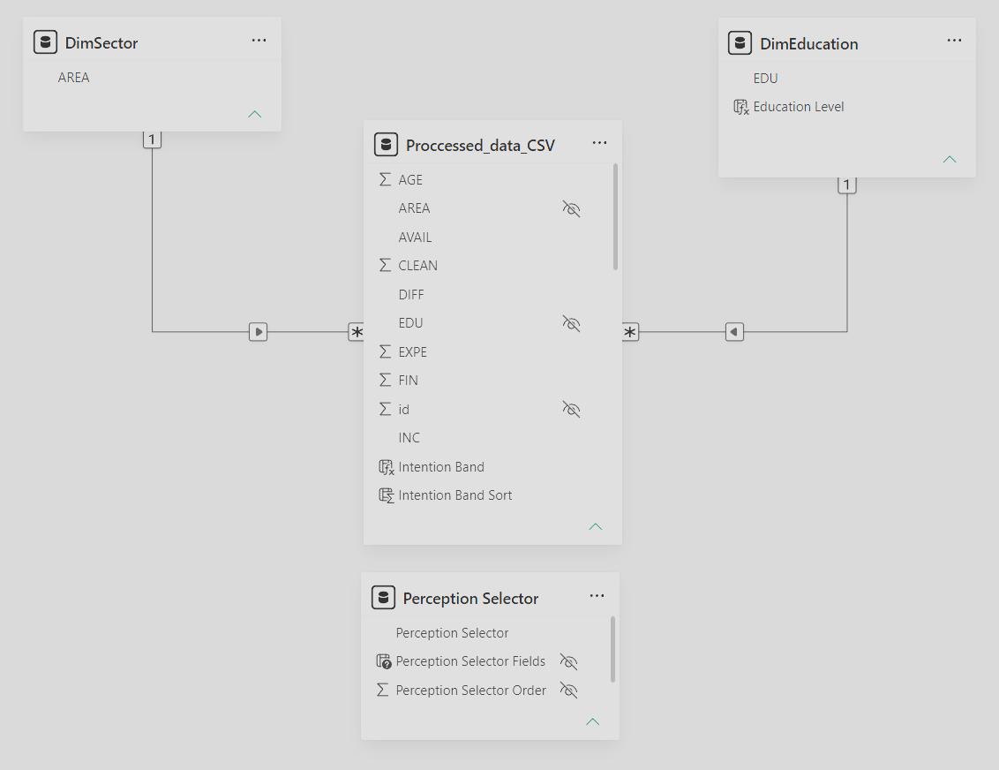

# Semantic model

This repo uses the public Mendeley Brufonctionnel survey dataset. Source: Dethier et al. (2023), Mendeley Data V1, [doi:10.17632/4n48pfcycx.1](https://doi.org/10.17632/4n48pfcycx.1). 

The repository records CC BY 4.0 attribution.

## Tables and grain

| Table | Grain / current rows | Key and role |
|---|---|---|
| `Proccessed_data_CSV` | One imported survey observation; 816 rows | `ObservationID` is the Power Query row index. Source `id` is not unique. |
| `DimSector` | One distinct AREA; 3 rows | Text `AREA`: Clothing, Mobility, Tooling. Derived from the fact query with select-columns and distinct. |
| `DimEducation` | One distinct EDU code; 7 rows | Integer `EDU`; derived with select-columns, distinct and ascending sort. DAX `Education Level` supplies labels, sorted by EDU. Codes 6 and 7 remain undocumented. |
| `Perception Selector` | One selectable perception; 4 calculated rows | Disconnected Field Parameter, not a survey dimension or a fact-filtering relationship. |

## Relationships and filtering

[`relationships.tmdl`](../consumer_adoption.SemanticModel/definition/relationships.tmdl) defines two joins:

| Many / From endpoint | One / To endpoint | Filter propagation |
|---|---|---|
| `Proccessed_data_CSV[AREA]` | `DimSector[AREA]` | DimSector → fact |
| `Proccessed_data_CSV[EDU]` | `DimEducation[EDU]` | DimEducation → fact |

Existing model view screenshot:

## Calculated fields and model settings

Fact DAX columns are `Intention Band` and `Intention Band Sort`. `DimEducation[Education Level]` is a DAX label column. The calculated parameter table maps Financial advantage → FIN (0), Trust → TRUST (1), Subscription dislike → SUB (2), Items unavailability → AVAIL (3). 
